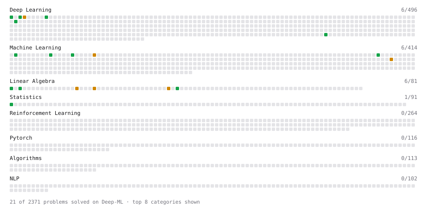

# Deep-ML

My machine learning practice from [Deep-ML](https://www.deep-ml.com). Every solution here was written by hand.

**27** solved · 18 problems · 0 labs · 9 math

[**Browse the interactive portfolio**](https://Vuanhhsgs.github.io/deep-ml/) to replay this filling in over time.

## Problems

| | Difficulty | Solved | |
| --- | --- | --- | --- |
| [Calculate Accuracy Score](https://www.deep-ml.com/problems/36) | easy | 2026-11-21 | [solution](problems/0036-calculate-accuracy-score) |
| [Calculate Covariance Matrix](https://www.deep-ml.com/problems/10) | easy | 2026-11-16 | [solution](problems/0010-calculate-covariance-matrix) |
| [Calculate Number of Parameters in Neural Network](https://www.deep-ml.com/problems/371) | easy | 2026-11-20 | [solution](problems/0371-calculate-number-of-parameters-in-neural-network) |
| [Check Linear Independence of Vectors](https://www.deep-ml.com/problems/331) | easy | 2026-11-16 | [solution](problems/0331-check-linear-independence-of-vectors) |
| [Gradient Direction and Magnitude](https://www.deep-ml.com/problems/308) | easy | 2026-11-21 | [solution](problems/0308-gradient-direction-and-magnitude) |
| [Implement ReLU Activation Function](https://www.deep-ml.com/problems/42) | easy | 2026-11-20 | [solution](problems/0042-implement-relu-activation-function) |
| [Linear Regression Using Gradient Descent](https://www.deep-ml.com/problems/15) | easy | 2026-11-21 | [solution](problems/0015-linear-regression-using-gradient-descent) |
| [Matrix-Vector Dot Product](https://www.deep-ml.com/problems/1) | easy | 2026-11-20 | [solution](problems/0001-matrix-vector-dot-product) |
| [Reshape Matrix](https://www.deep-ml.com/problems/3) | easy | 2026-11-20 | [solution](problems/0003-reshape-matrix) |
| [Run the Digit Network Forward](https://www.deep-ml.com/problems/1994) | easy | 2026-11-20 | [solution](problems/1994-run-the-digit-network-forward) |
| [Sigmoid Activation Function Understanding](https://www.deep-ml.com/problems/22) | easy | 2026-11-20 | [solution](problems/0022-sigmoid-activation-function-understanding) |
| [Single Neuron](https://www.deep-ml.com/problems/24) | easy | 2026-11-20 | [solution](problems/0024-single-neuron) |
| [Calculate Correlation Matrix](https://www.deep-ml.com/problems/37) | medium | 2026-11-16 | [solution](problems/0037-calculate-correlation-matrix) |
| [Find Captain Redbeard's Hidden Treasure](https://www.deep-ml.com/problems/127) | medium | 2026-11-21 | [solution](problems/0127-find-captain-redbeard-s-hidden-treasure) |
| [Gaussian Elimination for Solving Linear Systems](https://www.deep-ml.com/problems/58) | medium | 2026-11-16 | [solution](problems/0058-gaussian-elimination-for-solving-linear-systems) |
| [Matrix Rank](https://www.deep-ml.com/problems/329) | medium | 2026-11-16 | [solution](problems/0329-matrix-rank) |
| [Partial Derivatives of Multivariable Functions](https://www.deep-ml.com/problems/215) | medium | 2026-11-17 | [solution](problems/0215-partial-derivatives-of-multivariable-functions) |
| [Single Neuron with Backpropagation](https://www.deep-ml.com/problems/25) | medium | 2026-11-21 | [solution](problems/0025-single-neuron-with-backpropagation) |

## Math

| | Difficulty | Solved | |
| --- | --- | --- | --- |
| [Covariance and Correlation](https://www.deep-ml.com/math-problems/17) | medium | 2026-11-15 | [solution](math/0017-covariance-and-correlation) |
| [Determinants and Trace](https://www.deep-ml.com/math-problems/11) | medium | 2026-11-15 | [solution](math/0011-determinants-and-trace) |
| [Inverse and Rank](https://www.deep-ml.com/math-problems/12) | medium | 2026-11-15 | [solution](math/0012-inverse-and-rank) |
| [Least Squares and the Normal Equations](https://www.deep-ml.com/math-problems/34) | medium | 2026-11-15 | [solution](math/0034-least-squares-and-the-normal-equations) |
| [Matrix Calculus Identities](https://www.deep-ml.com/math-problems/35) | medium | 2026-11-16 | [solution](math/0035-matrix-calculus-identities) |
| [Multivariate Calculus](https://www.deep-ml.com/math-problems/2) | medium | 2026-11-16 | [solution](math/0002-multivariate-calculus) |
| [Neural Network Derivatives](https://www.deep-ml.com/math-problems/3) | medium | 2026-11-16 | [solution](math/0003-neural-network-derivatives) |
| [Orthogonality and Projections](https://www.deep-ml.com/math-problems/14) | medium | 2026-11-15 | [solution](math/0014-orthogonality-and-projections) |
| [Solving Linear Systems](https://www.deep-ml.com/math-problems/13) | medium | 2026-11-15 | [solution](math/0013-solving-linear-systems) |

---

_This file is regenerated by Deep-ML on every push._
